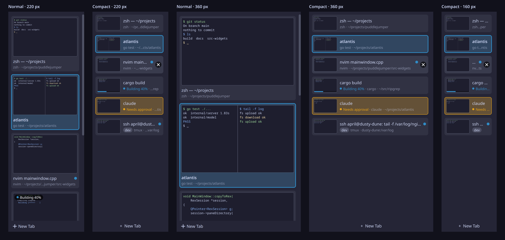

# Spec: a compact sidebar

Status: built (View ▸ Compact Sidebar, or Settings ▸ Tabs ▸ Compact cards).

## What and why

The thumbnail sidebar (`ThumbnailSidebar`, drawn by its `CardDelegate`) gives
each tab a card. At the top is a preview as wide as the sidebar, and under it
the title and a second line. At the default width of 220 px the preview is
about 186 × 112, so a card is about 165 px tall. A 900 px window shows five or
six tabs before the list scrolls.

Compact mode keeps the cards but turns them sideways. A small thumbnail sits
at the left, and the details are beside it to the right. A card becomes about
52 px tall, so about sixteen tabs fit in the same window. The thumbnail still
shows a tab's shape, colours and splits at a glance. You can't read its text,
and you don't need to: the details beside it carry the words.

```
 Normal (now)                     Compact
 ┌──────────────────────────┐     ┌──────────────────────────┐
 │ ┌──────────────────────┐ │     │ ┌──────┐ zsh — ~/proj  ● │
 │ │ ● Building   preview │ │     │ │ ▒▒▒▒ │ nvim · ~/proj   │
 │ │                      │ │     │ └──────┘                 │
 │ │                      │ │     ├──────────────────────────┤
 │ └──────────────────────┘ │     │ ┌──────┐ atlantis      ✕ │
 │ zsh — ~/projects       ● │     │ │ ▒▒│▒ │ ● Building 40%  │
 │ nvim · ~/projects        │     │ └▀▀▀───┘                 │
 └──────────────────────────┘     └──────────────────────────┘
```

It's a density option of the thumbnail sidebar, not a third tab layout. The
strip along the top doesn't change.



The mock-ups above show the real sidebar (normal) beside a prototype of the
compact card drawn to this spec with the same `cardstyle` helpers, at 2×. The
six tabs are: plain; current with a split; busy, with the mouse over it; a
build reporting progress; one waiting for approval; and a tmux tab with a
badge and a long title. At 220 px the normal sidebar shows three and a half
cards. Compact shows all six in under half the height.

## The card

Measurements are in logical pixels, using the existing constants (`kSide` 8,
`kGap` 4, `kPad` 6) wherever they fit.

- **Thumbnail.** It sits at the left of the card, inset `kPad`, and is
  vertically centred. Its height is fixed at **40**. Its width follows the
  terminal area's shape (`m_aspect`, the same as now), `40 / aspect`, held
  between **48 and 80**, so a very wide window can't take over the card. It
  keeps the rounded corners (`kPreviewRadius`) and the hairline outline.
- **Details column.** It runs from the thumbnail's right edge plus 8 to the
  card's right edge less `kPad`, centred vertically as a block:
  - Line 1 is the title, DemiBold when the tab is current, elided at the
    right. The new-output dot goes at the line's end, as now.
  - Line 2 is the subtitle in the small font, elided in the middle, as now.
    When a program has reported a status (OSC 7501), it **takes this line**:
    the status dot and label in the status colour, then `· subtitle` if there
    is room. A program's status matters more than the directory, and the
    thumbnail is too small for the status pill.
- **Row height.** `max(40, title height + 2 + small height) + 2·kPad + 2·kGap`,
  which comes to 60 with the default font on Linux. A larger font makes the row taller.
  It never makes the thumbnail taller.
- **Badge** (a tmux session, VNC, Web). This is a pill on the preview today.
  A 40 px thumbnail has no room for one, so it becomes a small chip in the
  same style, put before the subtitle on line 2: `[tmux] nvim · ~/proj`.
- **Progress.** The 3 px bar stays along the thumbnail's bottom edge, which
  reads fine at this size.
- **Close button.** It shows while the card is hovered, at the card's right
  edge, vertically centred. It takes the place of the end of the title and
  subtitle rather than covering the thumbnail. Middle-click still closes.
  `closeRect()` has to move with it, because hit-testing uses it.
- **Blocked tint, accent outline, hover lift.** These are unchanged; they're
  card-level (`cardstyle::paintCard`).
- **Tooltip.** Unchanged: the title and the status detail. It matters more
  here, because more gets elided.
- **Drag to reorder, context menu, New Tab footer, workspace header.** These
  are all unchanged.

## Turning it on

- **Setting.** Add `appearance/sidebarCompact` (bool, default false) beside
  `tabLayout` in `Settings::Appearance`, with `setSidebarCompact()` emitting
  `appearanceChanged` as the others do.
- **Settings dialog.** Under Tabs, add a "Compact cards" checkbox below
  Layout. It's enabled only while Layout is Thumbnail sidebar.
- **View menu.** Add **Compact Sidebar**, checkable, just after Thumbnail
  Sidebar. It's tagged for Rex as `client.sidebar.compact` (View) so it can
  be bound like `client.sidebar.toggle`. It does nothing visible with tabs
  along the top, but it is remembered.
- **No new shortcut by default.**

## Sidebar width

- Compact cards need **more** width than normal ones, not less: the
  thumbnail takes a fixed share and the details need the rest. The mock-ups
  showed this. At 120 px a 40 × 67 thumbnail leaves no room for details at
  all. At 160 px the titles elide to a few letters ("zsh — …", "cargo …"),
  and on a hovered card the close button squeezes the title to "…".
- So, in compact mode, the thumbnail narrows to its minimum (48 wide, still 40
  high, cropped rather than squashed) below 220 px. The sidebar's minimum
  width rises to **180** in compact mode. If the remembered width is below
  that, switching to compact widens the sidebar to 180, and switching back
  leaves it there.
- There's still one remembered width (`window/sidebarWidth`). Apart from the
  minimum above, switching modes doesn't resize the sidebar, so the two modes
  can be compared at the same width.

## How it's built

All of the painting change is in `thumbnailsidebar.cpp`; nothing else draws
cards.

1. **`CardDelegate` gains `bool compact`.** `previewRect()`, `closeRect()`
   and `rowHeight()` branch on it. `paint()` keeps one path for the card fill
   and the preview, then branches for where the text, badge, status and close
   button go.
2. **`ThumbnailSidebar::setCompact(bool)`** sets the delegate flag and the
   minimum width, then calls `updateItemSizes()`.
3. **`previewSize()`** returns the compact thumbnail size when compact. The
   size changes, so `updateItemSizes()` emits `previewSizeChanged` as it
   already does. The window already answers that by redrawing every preview
   (`refreshPreviews(true)`) at the new size. That's the only wiring the
   previews need.
4. **`MainWindow`** calls `m_sidebar->setCompact(...)` from the setting, in
   `updateTabLayout()` and on `appearanceChanged`. It also adds the View menu
   action.
5. **Settings** gets the key, the field, the setter and the dialog checkbox.

Smaller previews are also cheaper to draw. `TerminalTab::previewPixmap()`
scales each pane's screen into its box, so its cost goes down with the box.

## Checks

- **Offscreen probe.** The mock-up renderer (the scratch `sidebarmock`
  probe) becomes the check once the delegate is real. It draws the six tabs
  above in both modes at 180, 220 and 360 px and saves PNGs to review.
- **Delegate test.** In compact mode, `closeRect()` is inside the card and
  doesn't overlap the thumbnail. Clicking it closes the tab, and a click on
  the thumbnail doesn't.
- **Previews.** Toggling the mode emits `previewSizeChanged` once and the
  previews come back at the new size. Nothing is drawn at the old size and
  then stretched.
- **Persistence.** The setting survives a restart. The menu check and the
  dialog checkbox follow it however it was changed.

## Open questions

1. **Thumbnail height.** 40 looks right in the mock-ups: you can see the
   split, the colours and the progress bar, but not the text. It's still a
   guess. 32 fits more tabs; 48 shows more of
   the screen. One option is to make it follow the font (about 2.5 lines of
   the small font) so it scales with the UI.
2. **Thumbnail or icon?** A tab with nothing on screen yet (a new VNC
   connection, a Web tab still loading) shows a blank square. The badge text
   could go in its place instead.
3. **Status taking line 2.** Is it better to make the row taller and keep
   both the status and the subtitle?
4. **An automatic option.** Compact could kick in when the tabs wouldn't
   otherwise fit without scrolling. That might be a third value later
   ("Automatic"); it's left out to start.
